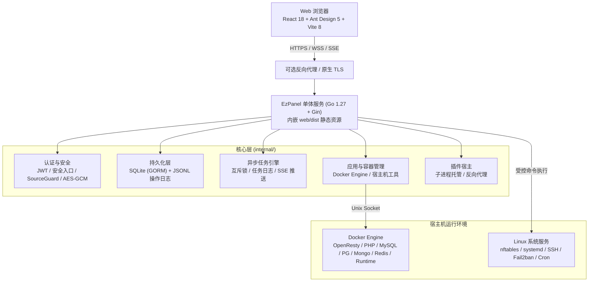

# 开发与构建

## 本地开发与构建

### 环境依赖
- **Go**：`1.27.4+`
- **Node.js**：`Node 24 LTS`（`web/package.json` 要求 `>=24.22.1 <25`）

### 常用开发命令

```bash
# 初始化本地开发面板（交互式生成 .dev-panel/）
make init-dev

# 同时启动后端开发服务与 Vite 前端热更新（默认 http://127.0.0.1:5173）
make dev

# 执行静态检查（go vet + ESLint 零警告 + Prettier 格式检查）
make lint

# 执行后端单元测试
make test

# 构建 Linux amd64 / arm64 发布产物与 SHA256SUMS（输出到 dist/）
make build VERSION=1.0.0
```

> 首次打开 Vite 开发地址前，请先在同一浏览器访问 `make init-dev` 输出的面板安全入口地址以获取入口 Cookie。

---

## 插件开发

EzPanel 提供完整的 Go 与 TypeScript 插件 SDK 以及示例工程，支持在面板中通过 ZIP 包动态安装与管理：

- 插件开发规范与接口文档：[docs/plugin-dev.md](plugin-dev.md)
- 插件 SDK 目录：[sdk/](../sdk/)
- 示例插件：[examples/hello-plugin/](../examples/hello-plugin/)
- 插件打包脚本：`scripts/pack-plugin.sh`

---

## 技术架构

### 整体架构



### 技术栈

| 层级 | 技术选型 | 说明 |
| --- | --- | --- |
| 后端语言与框架 | Go 1.27、Gin 1.12 | 单二进制部署，内嵌前端静态产物 |
| 数据存储 | SQLite（`glebarez/sqlite` + GORM）、JSONL | 纯 Go 无 CGO 依赖；敏感凭据使用 AES-GCM 加密 |
| 实时通信 | Gorilla WebSocket、SSE（Server-Sent Events） | 终端、系统监控、异步任务日志实时推送 |
| 离线归属地 | ip2region + MaxMindDB (MMDB) | 自动定期更新，内网与公网均本地解析 |
| 前端框架 | React 18、TypeScript 5.9、Vite 8 | 客户端路由与按需分包 |
| UI 与可视化 | Ant Design 5、Lucide Icons、ECharts 6 | 亮色/暗色主题切换，响应式布局 |
| 专业组件 | Monaco Editor、xterm.js 6、TanStack Query 5、Zustand 5 | 代码编辑、Web 终端、服务端状态与缓存管理 |

---

## 目录结构与运行布局

### 源码目录结构

```text
.
├── cmd/
│   ├── ezpanel/          # 面板主服务与 CLI（server / info / ready / version / reset-password / upgrade-check）
│   └── plugin-pack/      # 插件打包 CLI 工具
├── internal/
│   ├── auth/             # 会话认证、安全入口、Origin/SourceGuard 与操作审计
│   ├── config/           # 配置加载与运行时热更新
│   ├── eventstream/      # SSE 事件流封装
│   ├── executor/         # 受控宿主机命令执行器
│   ├── geoip/            # 离线 IPv4/IPv6 归属地查询与自动更新
│   ├── logview/          # 日志读取与分页检索
│   ├── pathsafe/         # 文件路径安全边界校验
│   ├── pkgmgr/           # Docker 容器应用、数据库多实例、安全升级与宿主机工具管理
│   ├── plugin/           # 插件安装、隔离托管与代理路由
│   ├── response/         # 统一 API 响应与错误码
│   ├── server/           # HTTP/TLS 监听与模块路由注册
│   ├── store/            # SQLite Schema、GORM 模型、AES-GCM 加密、JSONL 操作日志存储
│   ├── task/             # 异步任务队列、资源锁与实时日志
│   └── module/           # 业务模块（alerts / backup / certificate / cron / database / docker / file / oplog / phpmyadmin / security / settings / software / sysinfo / terminal / toolbox / waf / website）
├── web/                  # 前端工程（构建产物 web/dist 通过 go:embed 嵌入后端）
├── sdk/                  # 插件开发 SDK（Go 与 TypeScript）
├── examples/             # 示例插件（hello-plugin）
├── scripts/              # 安装 / 升级 / 回滚 / 卸载与插件打包脚本
├── docs/                 # 开发文档（plugin-dev.md）
├── Makefile              # 构建、开发、检查与测试入口
└── LICENSE               # GNU GPL-3.0 开源协议
```

### 生产运行目录布局

```text
/usr/local/bin/ezpanel    # 面板主程序与终端命令
/opt/ezpanel/             # 默认运行与数据根目录（可通过 --install-dir 自定义）
├── apps/                 # 容器化应用与数据库实例配置及持久化数据
├── log/                  # 统一日志根目录（panel/op_logs.jsonl、websites/、apps/）
├── data/                 # 面板私有数据（权限 0700：config.yaml、panel.db、geoip/、plugin/）
├── plugins/              # 已安装的自定义插件程序
├── tmp/                  # 面板临时文件目录（不进入升级快照）
├── trash/                # 文件管理与数据库回收站（不进入升级快照）
└── .snapshots/           # 升级与回滚快照目录（权限 0700）
```

---

## 自动发布

GitHub Actions 会检查 main 和 PR，并构建 Linux amd64、arm64 产物。推送 `vX.Y.Z` 标签时，构建会注入对应版本，并生成带签名的 Release。标签也可用 `vX.Y.Z-rN` 表示同版本的发布修订，程序版本仍为 `X.Y.Z`。`v0.*` 发布标记为预览版。

发布包附带对应源码、项目许可证、Go 与前端第三方依赖许可说明。发布步骤使用仓库限定的签名密钥；分支和 PR 的构建不接收签名密钥。
